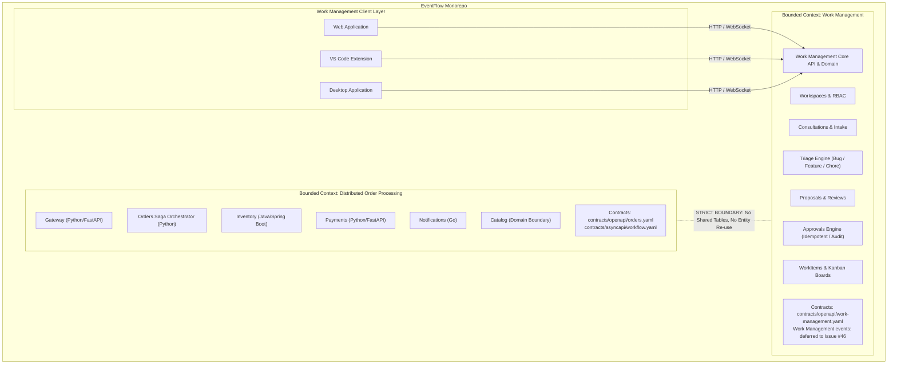
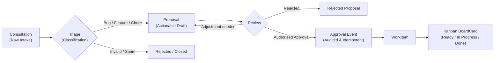

# ADR-006: Product Scope, Bounded Contexts, and Monorepo Architecture

## Status

Accepted

## Context

EventFlow was initially designed and documented as an educational and portfolio
platform to explore distributed-systems patterns in an e-commerce order workflow
(Gateway, Orders, Inventory, Payments, Notifications, and Catalog), as formalized
in [ADR-001](ADR-001-microservices.md) through [ADR-005](ADR-005-polyglot-service-architecture.md).
The baseline contracts under `contracts/` establish language-agnostic OpenAPI,
AsyncAPI, and JSON Schema specifications for distributed Order Saga coordination.

A new core capability has been introduced to the EventFlow roadmap: **Work
Management** (comprising Workspaces, Role-Based Access Control, Consultations
intake, Triage, Task Proposals, Approvals, WorkItems, and Kanban boards), designed
to serve three client interfaces: Webapp, VS Code Extension, and Desktop Application
(as cataloged in [Issue #1](https://github.com/jacksonsr451/EventFlow/issues/1) and
the task mindmap in [`docs/roadmap/task-mindmap.md`](../roadmap/task-mindmap.md)).

We must establish the structural relationship between these two domains.
Specifically, we need to decide whether to divide the initiative across separate
repositories or maintain a unified monorepo with explicit architectural boundaries,
while ensuring that the documented Order Saga contracts are not diluted, mutated,
or reused for work management entities.

## Decision

We adopt a **Monorepo architecture with two strictly isolated Bounded Contexts**:

1. **Distributed Order Processing (Order Saga Domain):** The original educational
   domain containing Gateway, Orders, Inventory, Payments, Notifications, and
   Catalog.
2. **Work Management (Consultation, Triage, and Task Domain):** The product
   management domain containing Workspaces, RBAC, Consultations, Triage, Proposals,
   Approvals, WorkItems, and Kanban Boards, serving Web, VS Code, and Desktop clients.

Both domains reside in this repository under clear structural separation, sharing
engineering standards, continuous integration, and infrastructure automation, but
maintaining zero semantic or transactional coupling.



### 1. Zero Entity and Persistence Coupling

Under no circumstance will entities, tables, or APIs of the Order Saga domain be
overloaded or repurposed for Work Management:

- Entities such as `Order`, `Cart`, `Reservation`, `Payment`, and `PriceQuote` belong
  exclusively to the Order Saga domain.
- Entities such as `Workspace`, `Consultation`, `TriageRecord`, `Proposal`, `Approval`,
  `WorkItem`, and `BoardCard` belong exclusively to the Work Management domain.
- Database schemas are completely independent. Each bounded context owns its
  tables and migrations. No foreign keys, cross-domain database queries, joins, or
  shared write transactions are permitted between the Order domain and the Work
  Management domain.
- Existing contracts under `contracts/openapi/orders.yaml`,
  `contracts/asyncapi/workflow.yaml`, and `contracts/schemas/*` remain intact and
  unmodified. Work Management contracts will be added in separate specification
  files under `contracts/`.

### 2. Mandatory Work Management Workflow

The Work Management domain enforces a strict lifecycle machine:

$$\text{Consultation} \longrightarrow \text{Triage} \longrightarrow \text{Proposal} \longrightarrow \text{Review \& Approval} \longrightarrow \text{WorkItem} \longrightarrow \text{BoardCard}$$



The domain enforces the following non-negotiable invariants:

- **Consultations are not tasks:** A consultation represents an initial inquiry or
  context capture (from user inputs, editor context, or web hooks). It does not
  enter a Kanban board and does not allocate implementation effort directly.
- **Differentiated triage:** Triage applies explicit criteria based on category:
  - *Bug:* Requires reproduction steps, affected environment/version, and severity.
  - *Feature:* Requires user story, expected business value, and acceptance criteria.
  - *Chore:* Requires technical motivation, maintenance scope, and regression risk.
- **Proposals require formal approval:** A proposal is a drafted work item that can
  be reviewed, rejected, or iterated on. Only authorized users with appropriate RBAC
  permissions can issue an approval.
- **Idempotent and auditable approvals:** Approval operations must accept an
  idempotency identifier. Re-submitting an approval operation for the same proposal
  never duplicates downstream WorkItems or BoardCards. Every approval creates a tamper-evident
  audit log recording the actor, timestamp, and proposal snapshot.
- **Atomic creation of cards:** Upon authorized approval, the generation of the
  `WorkItem` and its corresponding `BoardCard` is an atomic domain operation.

### 3. Monorepo Organization

The monorepo structure segregates responsibilities across clear top-level directories:

```text
EventFlow/
├── .github/              # Shared CI/CD workflows and automation
├── contracts/            # Machine-readable interface contracts (OpenAPI, AsyncAPI, Schemas)
│   ├── openapi/          # HTTP contracts (orders.yaml, work-management.yaml)
│   ├── asyncapi/         # Order workflow.yaml; Work Management events deferred to Issue #46
│   └── schemas/          # Common and domain-specific JSON Schemas
├── docs/                 # Architectural documentation, ADRs, and guides
│   ├── adr/              # Architecture Decision Records
│   ├── architecture/     # System-level and domain-level architectural descriptions
│   └── roadmap/          # Prioritized issue mindmap and delivery milestones
├── services/             # Backend services
│   ├── orders/           # Python/FastAPI - Order Saga orchestrator
│   ├── inventory/        # Java/Spring Boot - Authoritative stock & reservations
│   ├── payments/         # Python/FastAPI - Authoritative financial state
│   ├── notifications/    # Go - Asynchronous event consumer
│   └── work-core/        # Work Management domain backend, API, and persistence
├── apps/                 # User-facing client applications
│   ├── web/              # Web application (Shell, inbox, triage, review, kanban)
│   ├── desktop/          # Desktop application (Tauri / cross-platform shell)
│   └── vscode-extension/ # Visual Studio Code editor extension
├── packages/             # Shared client libraries, UI components, and API SDKs
│   ├── api-client/       # Contract-generated TypeScript API client
│   └── ui/               # Shared design system components
└── scripts/              # Shared repository quality and contract validation tooling
```

> **Note:** [ADR-007](ADR-007-multi-client-monorepo-layout-and-contracts.md)
> refines this layout for the client and package layer (Issue #3). Where the two
> disagree, ADR-007 is authoritative: `apps/` becomes `clients/`, and
> `services/work-core/` becomes `services/work-management/`. The bounded-context
> separation defined here is unchanged.

### 4. Client Integration and API-First Strategy

The three clients (Webapp, VS Code Extension, Desktop Application) interface with
Work Management exclusively through contract-driven, versioned APIs:

- **Unified Contracts:** Client adapters and TypeScript models are generated from
  the OpenAPI 3.1 and AsyncAPI 3.0 specifications. Business rules reside in the
  backend, ensuring parity and preventing client divergence.
- **Shared Authentication & RBAC:** All clients authenticate against a common
  session/token mechanism, respecting Workspace and Project permission boundaries
  ([Issue #9](https://github.com/jacksonsr451/EventFlow/issues/9) and
  [Issue #10](https://github.com/jacksonsr451/EventFlow/issues/10)).
- **Editor Context Capture:** The VS Code extension captures code context (file,
  line range, Git commit, repository identity) only with explicit developer
  consent, submitting it as metadata to a Consultation without bypassing the
  triage pipeline ([Issue #18](https://github.com/jacksonsr451/EventFlow/issues/18) /
  [Issue #24](https://github.com/jacksonsr451/EventFlow/issues/24)).
- **Offline and Synchronized Behavior:** The Desktop and VS Code clients utilize a
  local synchronization queue with conflict detection, deferring authoritative
  state transitions to the backend ([Issue #26](https://github.com/jacksonsr451/EventFlow/issues/26) /
  [Issue #42](https://github.com/jacksonsr451/EventFlow/issues/42)).

### 5. Incremental Evolution Strategy

Implementation will follow the prioritized critical path established in
[`docs/roadmap/task-mindmap.md`](../roadmap/task-mindmap.md):

1. **P0 Foundations (Architecture & Security):**
   [#1](https://github.com/jacksonsr451/EventFlow/issues/1) (Product & Bounded Contexts ADR),
   [#2](https://github.com/jacksonsr451/EventFlow/issues/2) (Workflow Specification),
   [#3](https://github.com/jacksonsr451/EventFlow/issues/3) (Monorepo & Client Contracts),
   [#35](https://github.com/jacksonsr451/EventFlow/issues/35) (Threat Model), and
   [#36](https://github.com/jacksonsr451/EventFlow/issues/36) (Documentation & Onboarding).
2. **P0 Backend Core & Domain:**
   [#9](https://github.com/jacksonsr451/EventFlow/issues/9) (Workspaces & RBAC),
   [#10](https://github.com/jacksonsr451/EventFlow/issues/10) (Authentication),
   [#11](https://github.com/jacksonsr451/EventFlow/issues/11) (Versioned API),
   [#12](https://github.com/jacksonsr451/EventFlow/issues/12) (Persistence & Migrations),
   followed by domain workflows [#4](https://github.com/jacksonsr451/EventFlow/issues/4)
   (Consultations), [#5](https://github.com/jacksonsr451/EventFlow/issues/5) (Triage),
   [#6](https://github.com/jacksonsr451/EventFlow/issues/6) (Proposals),
   [#7](https://github.com/jacksonsr451/EventFlow/issues/7) (Approvals), and
   [#8](https://github.com/jacksonsr451/EventFlow/issues/8) (Kanban Boards).
3. **P0 Quality & Operations:**
   [#33](https://github.com/jacksonsr451/EventFlow/issues/33) (Multi-toolchain CI),
   [#34](https://github.com/jacksonsr451/EventFlow/issues/34) (Local Dev Infra),
   [#32](https://github.com/jacksonsr451/EventFlow/issues/32) (E2E Flow Tests), and
   [#47](https://github.com/jacksonsr451/EventFlow/issues/47) (Tenant Isolation).
4. **P1 Clients & Integrations:**
   [#49](https://github.com/jacksonsr451/EventFlow/issues/49) (Preserve Order Saga Contracts),
   Webapp ([#13](https://github.com/jacksonsr451/EventFlow/issues/13),
   [#14](https://github.com/jacksonsr451/EventFlow/issues/14),
   [#21](https://github.com/jacksonsr451/EventFlow/issues/21),
   [#22](https://github.com/jacksonsr451/EventFlow/issues/22)),
   VS Code & Desktop ([#23](https://github.com/jacksonsr451/EventFlow/issues/23),
   [#24](https://github.com/jacksonsr451/EventFlow/issues/24),
   [#25](https://github.com/jacksonsr451/EventFlow/issues/25)),
   Realtime & Outbox ([#26](https://github.com/jacksonsr451/EventFlow/issues/26),
   [#46](https://github.com/jacksonsr451/EventFlow/issues/46)), and
   External Integrations ([#27](https://github.com/jacksonsr451/EventFlow/issues/27),
   [#29](https://github.com/jacksonsr451/EventFlow/issues/29),
   [#44](https://github.com/jacksonsr451/EventFlow/issues/44)).
5. **P2/P3 Advanced Capabilities & Order Saga Execution:**
   Advanced work management ([#28](https://github.com/jacksonsr451/EventFlow/issues/28),
   [#30](https://github.com/jacksonsr451/EventFlow/issues/30),
   [#31](https://github.com/jacksonsr451/EventFlow/issues/31),
   [#41](https://github.com/jacksonsr451/EventFlow/issues/41),
   [#42](https://github.com/jacksonsr451/EventFlow/issues/42),
   [#43](https://github.com/jacksonsr451/EventFlow/issues/43),
   [#48](https://github.com/jacksonsr451/EventFlow/issues/48)),
   AI assistance ([#45](https://github.com/jacksonsr451/EventFlow/issues/45)), and
   Order Saga service implementations ([#50](https://github.com/jacksonsr451/EventFlow/issues/50),
   [#51](https://github.com/jacksonsr451/EventFlow/issues/51),
   [#52](https://github.com/jacksonsr451/EventFlow/issues/52),
   [#53](https://github.com/jacksonsr451/EventFlow/issues/53),
   [#54](https://github.com/jacksonsr451/EventFlow/issues/54)), conditioned on
   prioritization and environment readiness.

## Consequences

### Positive

- **Clarity of domain boundaries:** Eliminates semantic confusion and avoids
  contaminating e-commerce data structures with task management semantics.
- **Asset preservation:** The established machine-readable contracts and educational
  study value of the Order Saga remain 100% valid and preserved.
- **Cohesive developer experience:** A single repository maintains unified
  validation scripts, pre-commit standards, shared documentation, and aligned
  milestones.
- **Multi-client integrity:** Client applications consume authoritative contracts,
  preventing divergence of business logic across Web, Desktop, and Editor interfaces.
- **Traceable evolution:** Architectural progress is mapped directly to existing
  GitHub issues through an unambiguous critical path.

### Negative

- **Monorepo governance:** Supporting Python, Java, Go, TypeScript/Node.js, and
  client frameworks in a single repository requires disciplined tooling, scoped
  CI triggers, and careful dependency isolation.
- **Cognitive complexity:** Contributors must maintain clear mental models of two
  distinct bounded contexts and strictly avoid accidental cross-domain dependencies.
- **Build and test matrix expansion:** As client apps and additional services are
  implemented, local development environments and CI pipelines will require more
  resources and caching optimizations.

## Alternatives Considered

- **Separate Repositories (Multi-Repo):** Splitting Work Management into a separate
  GitHub repository was rejected because it fragments project documentation, duplicates
  CI/CD setup and developer tooling, breaks the unified 55-issue planning roadmap,
  and complicates future shared infrastructure.
- **Subsuming Work Items into the Order Entity:** Reusing `Order` as a generic "work
  order" was rejected as an anti-pattern. E-commerce orders require financial amounts,
  currency codes, cart reservations, and payment voids/refunds. Conflating these
  with consultations, triage, bug reports, and Kanban stages causes model corruption.
- **Discarding the Order Saga Domain:** Deleting the distributed order processing
  domain was rejected because it represents a primary educational goal of the project
  and has complete contract coverage already committed in the repository.

## Notes

- See [overview](../architecture/overview.md) for top-level system context.
- See [task-mindmap](../roadmap/task-mindmap.md) for issue dependencies.
- The Workflow Specification for [Issue #2](https://github.com/jacksonsr451/EventFlow/issues/2)
  is documented in [work-management-workflow.md](../architecture/work-management-workflow.md).
- [ADR-007](ADR-007-multi-client-monorepo-layout-and-contracts.md) defines the
  multi-client monorepo layout and shared contracts for
  [Issue #3](https://github.com/jacksonsr451/EventFlow/issues/3). It supersedes
  the directory naming in section 3 above while preserving every bounded-context
  invariant.
