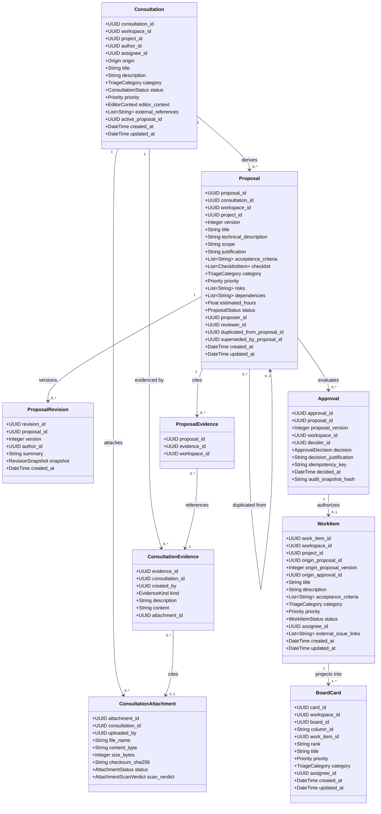
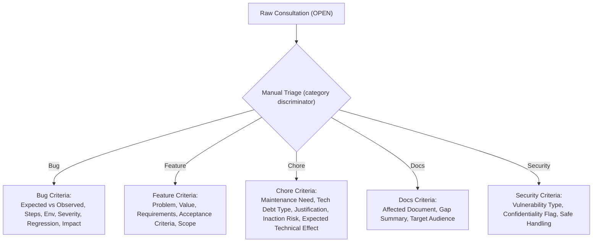
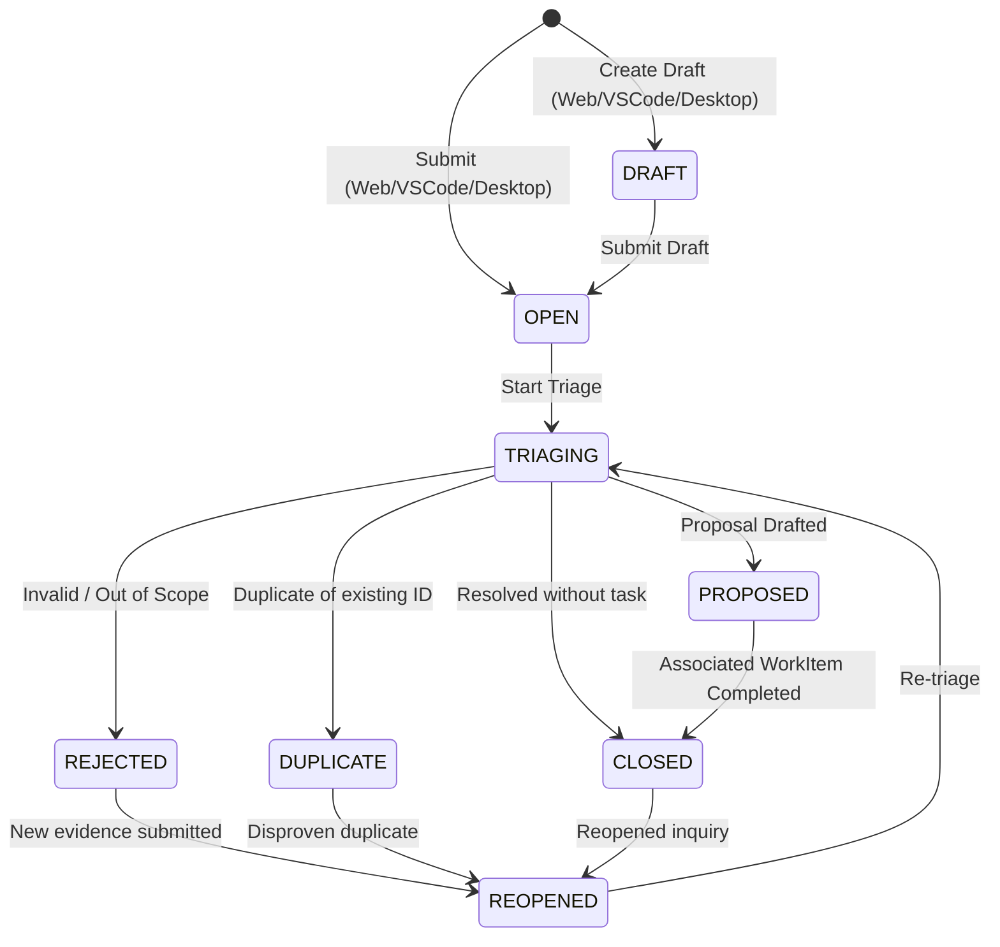
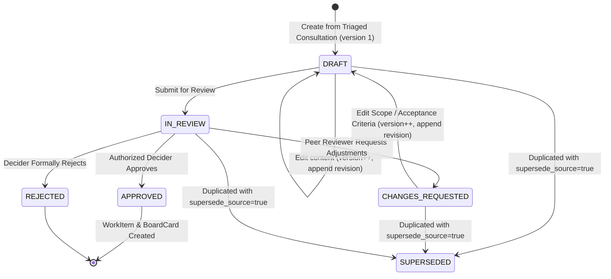
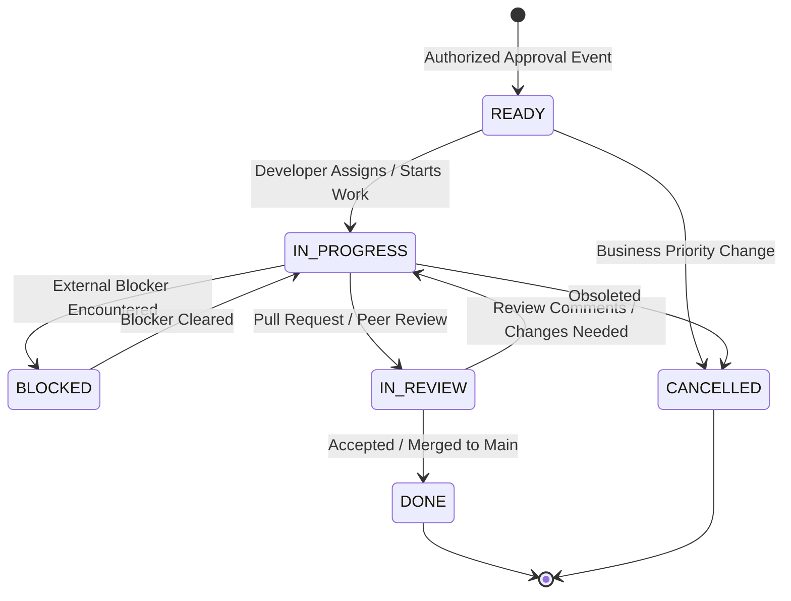
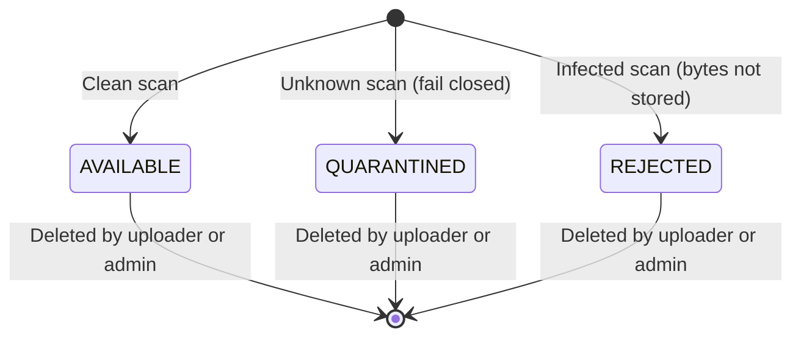
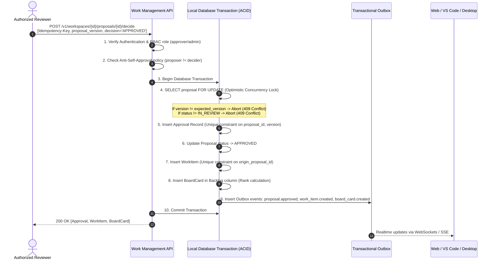
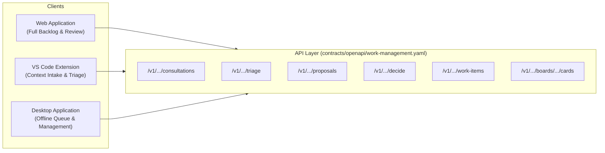

# Work Management Domain: Workflow, State Machines, and Approval Specification

## Status

Accepted architectural specification subordinate to [ADR-006](../adr/ADR-006-product-scope-and-bounded-contexts.md)
and governing the implementation of [Issue #2](https://github.com/jacksonsr451/EventFlow/issues/2).

## Context and Purpose

As established in [ADR-006](../adr/ADR-006-product-scope-and-bounded-contexts.md),
EventFlow incorporates a dedicated **Work Management** bounded context strictly
isolated from the legacy distributed order processing domain.

This document formally specifies the domain entities, triage criteria, state
machines, transition matrices, approval mechanics, atomicity and idempotency
guarantees, and client contracts required to support the full lifecycle:

$$\text{Consultation} \longrightarrow \text{Triage} \longrightarrow \text{Proposal} \longrightarrow \text{Review} \longrightarrow \text{Approval} \longrightarrow \text{WorkItem} \longrightarrow \text{BoardCard}$$

## 1. Domain Entities and Boundary Invariants

The domain models five distinct entities. No entity may substitute for another,
and none may inherit or reuse tables or identifiers from the Order Saga domain.



### Entity Responsibilities and Non-Negotiable Invariants

1. **Consultation:**
   - *Responsibility:* Raw intake mechanism capturing user inquiries, reported problems,
     feature suggestions, or technical discussions from Web, VS Code, Desktop, or external webhooks.
   - *Invariants:*
     - A Consultation is **never** an approved task and **cannot** be scheduled directly on a Kanban board.
     - Context captured via the VS Code extension (`editor_context`) strictly requires developer consent (`consent_granted: true`).
     - A Consultation may be closed, rejected, or marked as duplicate without ever producing a Proposal.
2. **Proposal:**
   - *Responsibility:* An independent structured technical proposal derived from a
     triaged Consultation. Contains technical scope, acceptance criteria, a
     checklist, evidence links, architectural impact, and its own revision history.
   - *Invariants:*
     - One triaged Consultation may yield **zero, one, or many** independent
       Proposals; the relationship is 1→N and is never collapsed.
     - Each Proposal has its own identity and its own `version` counter starting at
       1, so two Proposals of the same Consultation are both version 1 and are
       distinguished by `proposal_id`.
     - Creating, editing, previewing, submitting, or duplicating a Proposal
       **does not** create an `Approval`, `WorkItem`, `BoardCard`, or remote issue,
       and never allocates execution capacity.
     - Any accepted content modification increments the Proposal's `version` and
       appends an immutable `ProposalRevision` snapshot; revision history is
       append-only and never rewritten.
3. **Approval:**
   - *Responsibility:* The formal, auditable decision record issued by an authorized reviewer
     evaluating a specific `(proposal_id, proposal_version)`.
   - *Invariants:*
     - Approvals bind strictly to an exact proposal version. An approval for version 1 **never** authorizes version 2.
     - Self-approval is restricted by workspace RBAC policy (the author of a proposal cannot approve it unless explicit single-user mode is active).
     - An approval operation is strictly idempotent through client-provided `Idempotency-Key`.
4. **WorkItem:**
   - *Responsibility:* The authoritative unit of actionable work authorized for development.
   - *Invariants:*
     - A `WorkItem` can **only** be created following a valid, authorized `Approval` with decision `APPROVED`.
     - Direct creation of a `WorkItem` bypassing the Consultation/Proposal/Approval pipeline is prohibited.
     - Copies the immutable snapshot of acceptance criteria and technical scope approved in the Proposal.
5. **BoardCard:**
   - *Responsibility:* Visual representation, ordering, and board placement of a `WorkItem`.
   - *Invariants:*
     - A `BoardCard` cannot exist without a backing `WorkItem`.
     - Moving a card between columns mirrors or validates against allowable `WorkItem` operational transitions (e.g., WIP limits).
     - Deleting or archiving a card does not delete the authoritative `WorkItem`.

---

## 2. Differentiated Triage Criteria

Every raw consultation must undergo manual categorization during triage before a
Proposal can be created. Triage is a **category-discriminated union**: the
triager selects exactly one category and supplies that category's structured
criteria, and no other. Categories enforce distinct criteria to maintain input
quality:



A misclassified consultation can be **manually reclassified** once triage has
completed. Reclassification requires an explicit justification, replaces the
category, priority, and criteria, and appends a `consultation.reclassified` audit
record carrying the previous and new category and criteria snapshot. Neither
triage nor reclassification is automatic, and neither creates a Proposal,
Approval, WorkItem, or BoardCard.

### 1. Bug
- **Expected vs. Observed Behavior:** Clear contrast between what the system should do and what it did.
- **Reproduction Steps:** Sequential, deterministic steps to replicate the defect.
- **Environment and Version:** Runtime version, operating system, browser/client build, commit hash.
- **Impact and Severity:** Critical (service outage/data corruption), High (core flow blocked), Medium (workaround available), Low (cosmetic).
- **Regression Analysis:** Identifies whether the bug was introduced in a known recent release or commit.

### 2. Feature
- **Problem Statement & Opportunity:** The user pain point or business capability addressed.
- **Expected Value:** Quantifiable efficiency gain, developer productivity improvement, or user benefit.
- **Functional Requirements:** Granular behavioral specifications.
- **Acceptance Criteria:** Objective, testable assertions required for completion.
- **Scope:** The boundary of the change (what is and is not included).

### 3. Chore
- **Maintenance Need:** Dependency upgrades, deprecation removals, code refactoring, or CI optimizations.
- **Technical Debt Classification:** Architectural, testing, documentation, or operational debt.
- **Justification & Inaction Risk:** Consequences if deferred (security vulnerability, build slowdown, fragility).
- **Expected Technical Effect:** The concrete, verifiable outcome (e.g., zero build warnings, updated dependencies).

### 4. Docs
- **Affected Documentation:** Absolute path or URL of existing documents or location for new guides.
- **Inconsistency or Gap:** Discrepancy between code behavior and documented claims.
- **Target Audience:** Contributors, system operators, API consumers, or end users.
- **Deliverable:** Reviewed markdown files passing repository contract and link validation.

### 5. Security (Special Protected Handling)
- **Vulnerability Classification:** CWE category, injection, authorization bypass, data exposure, etc.
- **Confidentiality Level:** Flagged as `confidential` or `restricted`. Access is restricted strictly to designated security maintainers.
- **Safe Evidence Handling:** Exploit payloads or proofs of concept are stored in encrypted, access-controlled storage; **never** logged to stdout, plaintext tables, or distributed notifications.
- **Responsible Disclosure Process:** Coordinated fix timeline prior to public release or changelog disclosure.

---

## 3. State Machines and Lifecycle Workflows

### 3.1 Consultation State Machine



### 3.2 Proposal State Machine



A `DRAFT` or `CHANGES_REQUESTED` proposal is editable; each accepted content
change increments `version` and appends an immutable revision. A proposal in any
non-`SUPERSEDED` state may be duplicated, optionally marking the source
`SUPERSEDED`.

### 3.3 WorkItem State Machine



### 3.4 Consultation Attachments, Evidence, and History

Attachments and evidence are supporting records that enrich a Consultation
without changing its identity or bypassing triage. They are not part of the
Consultation → Proposal → Approval → WorkItem → BoardCard chain and never create
a Proposal, Approval, WorkItem, or BoardCard.

- **Attachment lifecycle.** An upload is validated (filename, size, declared vs.
  sniffed content type against a published allowlist), then scanned through an
  injected, fail-closed scanner. A `clean` verdict becomes `available`; an
  `unknown` verdict is `quarantined` and never downloadable; an `infected`
  verdict is `rejected` and its bytes are not stored. Every outcome is recorded
  in the append-only audit trail. Deletion removes the object and its metadata
  and is restricted to the uploader or a workspace administrator.
- **Evidence.** Evidence is `text`, `link`, or a reference to an `available`
  attachment in the same consultation; a quarantined or rejected attachment can
  never be cited. Text and link evidence require inline `content`.
- **History.** The consultation history endpoint is a read-only,
  cursor-paginated projection of the append-only audit records for that
  consultation, so intake, draft edits, triage, uploads, evidence, and deletion
  appear as one ordered timeline.



### 3.5 Proposal Revisions, Evidence, and Duplication (Issue #6)

A Proposal is an independent aggregate derived from a triaged Consultation.
Triage must have completed (a recorded `triaged_at`) and the Consultation must be
`TRIAGING`, `PROPOSED`, or `REOPENED`; otherwise creation and preview return
`409 INVALID_STATE`. One Consultation may produce many Proposals, each with its
own `proposal_id` and its own `version` counter starting at 1.

- **Revisions.** The first accepted creation records revision 1. Every accepted
  content edit on a `DRAFT`/`CHANGES_REQUESTED` proposal increments `version` and
  appends an immutable `ProposalRevision` snapshot (the canonical proposal
  content at that version). The revision list is read-only and cursor-paginated;
  history is never mutated. The append-only trigger
  `eventflow_proposal_revisions_block_mutation` rejects `UPDATE`/`DELETE`/`TRUNCATE`
  at the database level.
- **Preview.** A proposal can be validated and normalized without persisting
  anything, returning a prospective version-1 draft.
- **Evidence.** A Proposal may cite `ConsultationEvidence` from the same
  Consultation through `ProposalEvidence`; quarantined or foreign evidence can
  never be cited.
- **Duplication.** Duplicating a proposal creates a new independent `DRAFT` at
  version 1 whose `duplicated_from_proposal_id` points at the source. With
  `supersede_source: true` the source becomes `SUPERSEDED` and records
  `superseded_by_proposal_id`. Duplication never creates an Approval, WorkItem,
  BoardCard, or remote issue.
- **Audit.** The append-only audit actions are `proposal.created`,
  `proposal.revised`, `proposal.submitted`, and `proposal.duplicated`.

### 3.6 Configurable Boards, Columns, and Card Movement (Issue #8)

A Board is a persistent, configurable Kanban surface. Its columns are
independently managed resources (`board_columns`), each with a stable `key`, an
ordered `position`, a canonical `mapped_status` (one of the WorkItem status
values) and an optional `wip_limit`. Board and column mutations require
`board:manage` (`contributor` or higher); reads require `board:read`.

- **Column management.** Columns are created, reordered, renamed and deleted
  through dedicated endpoints. Deleting a column that still holds cards returns
  `409 COLUMN_NOT_EMPTY`; deleting a board's last column returns
  `409 LAST_COLUMN`. Positions are renumbered to `0..n-1` inside the
  transaction, and `Board.columns` is kept in sync as the ordered key list.
- **Card moves.** A move supplies a `target_column_id` (a column key) and a
  `target_rank` anchor. The service locks the board, card, target column and
  WorkItem, validates the lifecycle transition, enforces the destination WIP
  limit, computes a deterministic rank, updates the card and WorkItem, appends a
  `card_movements` row, writes an audit record and commits once.
- **Lifecycle transitions (server-authoritative).** `ready → in_progress`;
  `in_progress → in_review`; `in_review → done`; a same-status move is a valid
  visual reorder; `blocked` and `cancelled` are reachable as specified. An
  invalid edge returns `409 INVALID_TRANSITION`.
- **WIP limits.** A non-null `wip_limit` rejects a move into a full column with
  `409 WIP_LIMIT_EXCEEDED`. Because the destination column row is locked for the
  move, concurrent writers cannot both exceed the limit.
- **Ordering.** Ranks are a variable-length lexicographic fractional index
  (base-62, seeded `U`), so a rank can always be placed strictly between two
  neighbours; an exhausted key space returns `409 RANK_SPACE_EXHAUSTED` rather
  than renumbering silently.
- **Movement history.** `GET .../cards/{card_id}/movements` returns a
  cursor-paginated, append-only projection of accepted moves.
- **No direct card creation.** Cards remain a projection of approved work. There
  is deliberately no `POST .../cards` endpoint; direct creation is **blocked by
  architecture** until an authorizing decision exists (see ADR-008 Amendment
  A-03).

### 3.7 Entity Collaboration: Comments, Attachments, and History (Issue #29)

Consultations, proposals, work items, and board cards share one collaboration
surface rooted at
`/v1/workspaces/{workspace_id}/{entity_collection}/{entity_id}`. The
`entity_collection` segment is `consultations`, `proposals`, `work-items`, or
`board-cards` (the last is flat: `/board-cards/{card_id}`). The server resolves
the entity inside the workspace; an unknown collection and a foreign entity are
both `404`.

- **Comments.** Comments are annotations, never authoritative state. Creation
  derives the author from the verified principal, trims and bounds the body
  (1–4,000 characters), and appends `comment.created` to the audit trail.
  Deletion is a tombstone: the row, author, and audit entry remain, but the API
  returns a null body. There is no edit operation, and a database trigger rejects
  any attempt to rewrite the author, body, target, or creation time.
- **Attachments.** Proposals, work items, and board cards use the generic
  attachment tables; consultations keep the Issue #4 pipeline. Both paths share
  the same size bound, filename rules, content-type sniffing, malware scan, and
  fail-closed quarantine. Quarantined or rejected objects are never
  downloadable. Each entity holds at most 25 attachments.
- **History.** `GET .../{entity_collection}/{entity_id}/history` projects the
  append-only audit trail for that entity, oldest first. History entries can
  never be created, rewritten, or deleted through the API. Consultation history
  keeps its specific Issue #4 path.
- **No downstream creation.** Commenting on or attaching a file to an entity
  never creates a Proposal, Approval, WorkItem, or BoardCard.

### 3.8 Project Repository Configuration (Issue #44)

A project may reference zero or more remote GitHub/GitLab repositories through
`/v1/workspaces/{workspace_id}/projects/{project_id}/repositories`. This is
configuration metadata only: it does not clone a repository, inspect branches,
link issues, synchronize state, or mutate the provider, and it never creates a
Proposal, Approval, WorkItem, or BoardCard.

- **Stable identity.** A link is identified by provider, provider host
  (`provider_instance_id`, not an installation id), and provider-assigned
  repository id within one project. The same remote can be configured on
  multiple projects; the same repository id on a different host is a different
  remote. URL variants (HTTPS, SSH, scp-style, `.git`) cannot create duplicates.
- **Lifecycle.** `active → inactive` deactivates the link; `PATCH status:
  active` reactivates it. `DELETE` archives it, which is terminal and preserves
  history; the remote repository is untouched. A subsequent link attempt for the
  same identity is rejected until a future explicit re-link decision exists.
  `PATCH status: archived` is not a supported transition.
- **Authorization.** Reading requires workspace membership; creating, updating,
  deactivating/reactivating, and archiving require `owner` or `admin`.
- **Concurrency.** `PATCH` and `DELETE` accept `If-Match` and return `412` on a
  stale validator. POST/PATCH/DELETE accept `Idempotency-Key`; equivalent
  retries replay the stored result. Archive is idempotent (`204` when already
  archived).

Deliberately absent: provider credential storage, installation ids, webhooks,
sync cursors, verification calls, cloning, and remote issue creation or updates.

### 3.9 Business Priority, SLA, Dependencies and Notifications (Issue #30)

Issue #30 attaches business-facing scheduling to an approved WorkItem without
changing the approval gate. The single source of truth for the business
priority matrix is `services/priority.py`.

- **Priority.** `business_impact` and `business_urgency` are optional triage
  inputs that must be supplied together; a disagreement with the submitted
  `priority` requires a `priority_override_reason`. Bug and security severity
  are separate criteria and never feed the matrix. An explicit WorkItem override
  preserves the matrix-derived `calculated_priority`, requires a 10-300
  character reason, is audited, and notifies the assignee.
- **SLA policy versions.** Policy versions are immutable; a change creates a
  new version. At most one version is active per name and scope (workspace
  default or project), and activation retires the previous one. Each version
  pins the response/resolution budgets, timezone, business hours, holidays,
  pause statuses, and warning threshold.
- **Durable clocks.** Starting a WorkItem creates one SLA instance pinned to the
  policy version snapshot, with `started_at` at WorkItem creation. Working time
  excludes holidays and non-working hours, and pauses (default `blocked`) shift
  the due dates. Statuses are `pending`, `running`, `paused`, `fulfilled`,
  `breached`, and `cancelled`. Events and pause intervals are append-only;
  warnings and breaches are recorded during read as well as by the worker.
- **Dependencies.** A directed edge records that one WorkItem blocks another.
  Duplicate edges converge, self-edges are rejected, and cycles are rejected
  (`409 DEPENDENCY_CYCLE`) under a workspace-scoped advisory lock. Moving a
  WorkItem to `done` while a blocker is unresolved is rejected
  (`409 DEPENDENCIES_UNRESOLVED`).
- **Notifications.** Emission is transactional with the domain change,
  deduplicated per `(workspace_id, dedup_key)`, and uses trusted recipients
  only; a missing recipient is a no-op. In-app delivery is immediate; email has
  no transport in this scope (`unavailable`) and uses bounded retries. Actors
  read and mark only their own notifications and manage their own per-event
  channel preferences. Protected security detail is never copied into
  notification content.

Deliberately absent: an external notification provider, webhook delivery, and
cross-workspace recipient discovery.

---

## 4. Comprehensive Transition Matrix

The "Authorized Role" column uses descriptive role names. The authoritative RBAC
vocabulary is owned by [Issue #9](https://github.com/jacksonsr451/EventFlow/issues/9)
(`owner`, `admin`, `triager`, `approver`, `contributor`, `viewer`); the public
API declares each operation's allowed roles in `x-required-roles`
([work-management-api.md](work-management-api.md)). The descriptive names map as
follows: *Any Authenticated / Author / Proposer / Assignee* → `contributor`;
*Triager / Maintainer* → `triager`; *Reviewer / Approver* → `approver`;
*Admin* → `admin` / `owner`.

| Entity | From State | To State | Authorized Role | Pre-conditions | Invariants Enforced | Side Effects & Domain Events | Error Codes |
|---|---|---|---|---|---|---|---|
| **Consultation** | `None` | `DRAFT` | `Author` | Valid title and description; optional reporter category; consent granted if editor context present | Status initialized to `DRAFT`; not eligible for triage | `consultation.draft_created` event published | `400 Bad Request` |
| **Consultation** | `DRAFT` | `DRAFT` | `Author`, `Admin` | Draft is in `DRAFT` state; `If-Match` valid when supplied | Editable fields only; status unchanged | `consultation.draft_updated` event published | `403 Forbidden`, `409 Conflict`, `412 Precondition Failed` |
| **Consultation** | `DRAFT` | `OPEN` | `Author`, `Admin` | Draft is in `DRAFT` state; `If-Match` valid when supplied | Status becomes `OPEN`; eligible for triage | `consultation.submitted` event published | `403 Forbidden`, `409 Conflict`, `412 Precondition Failed` |
| **Consultation** | `None` | `OPEN` | `Any Authenticated` | Valid title and description; consent granted if editor context present | Status initialized to `OPEN` | `consultation.created` event published | `400 Bad Request` |
| **Consultation** | `OPEN` | `TRIAGING` | `Triager`, `Maintainer` | Consultation is in `OPEN` or `REOPENED` | Category and priority must be assigned | `consultation.triaged` event published | `409 Conflict` |
| **Consultation** | `TRIAGING` | `PROPOSED` | `Author`, `Maintainer` | A valid Proposal references this `consultation_id` | `active_proposal_id` linked | Consultation status locked to `PROPOSED` | `400 Bad Request`, `409 Conflict` |
| **Consultation** | `TRIAGING` | `REJECTED` | `Triager`, `Maintainer` | Explicit rejection justification required | No active proposal may exist | `consultation.rejected` event published | `400 Bad Request` |
| **Consultation** | `TRIAGING` | `DUPLICATE` | `Triager`, `Maintainer` | Valid target `duplicate_of_id` supplied | Target consultation must exist | Linked to parent consultation | `404 Not Found` |
| **Proposal** | `None` | `DRAFT` | `Proposer` | Triage completed; origin Consultation is in `TRIAGING`, `PROPOSED`, or `REOPENED` | `version` starts at 1 for this `proposal_id`; revision 1 appended | Proposal record created; does **not** create WorkItem | `400 Bad Request`, `404 Not Found`, `409 INVALID_STATE` |
| **Proposal** | `DRAFT` | `DRAFT` | `Proposer`, `Admin` | Proposal is `DRAFT`/`CHANGES_REQUESTED`; `If-Match` valid when supplied | `version` incremented; immutable revision appended | `proposal.revised` audit recorded; no downstream work | `403 Forbidden`, `409 INVALID_STATE`, `412 Precondition Failed` |
| **Proposal** | `DRAFT` | `IN_REVIEW` | `Proposer`, `Maintainer` | Complete technical description, scope, and $\ge 1$ acceptance criteria | Status changes to `IN_REVIEW` | `proposal.submitted` audit recorded | `422 Unprocessable Entity` |
| **Proposal** | `IN_REVIEW` | `CHANGES_REQUESTED` | `Reviewer`, `Approver` | Decider cannot be proposer (if anti-self-approval active); justification provided | Decision recorded as `CHANGES_REQUESTED` | `proposal.changes_requested` event published | `403 Forbidden` |
| **Proposal** | `CHANGES_REQUESTED` | `DRAFT` | `Proposer` | New revision prepared; `version` incremented by 1 | Immutable revision appended; no version is mutated in place | New revision available in history | `409 Conflict` |
| **Proposal** | `DRAFT`, `CHANGES_REQUESTED`, `IN_REVIEW` | `SUPERSEDED` | `Proposer`, `Contributor`, `Triager`, `Approver`, `Admin` | Duplicate created with `supersede_source: true`; source not already `SUPERSEDED` | `superseded_by_proposal_id` set to the new copy | `proposal.duplicated` audit recorded; source becomes terminal | `404 Not Found`, `409 Conflict` |
| **Proposal** | `IN_REVIEW` | `REJECTED` | `Approver`, `Admin` | Decider possesses `approver` RBAC role; justification provided | Decision recorded as `REJECTED`; terminal for this version | `proposal.rejected` event published | `403 Forbidden`, `409 Conflict` |
| **Proposal** | `IN_REVIEW` | `APPROVED` | `Approver`, `Admin` | Decider possesses `approver` RBAC role; `proposal_version` matches current; `Idempotency-Key` present | Proposal locked to `APPROVED`; generates WorkItem & BoardCard atomically | `proposal.approved`, `work_item.created`, `board_card.created` events | `403 Forbidden`, `409 Conflict` |
| **WorkItem** | `None` | `READY` | `System (Approval Handler)` | Generated exclusively via valid, authorized `Approval` | Copies immutable acceptance criteria snapshot | Atomically placed on initial Board column | `500 Internal Error` (atomic rollback) |
| **WorkItem** | `READY` | `IN_PROGRESS` | `Assignee`, `Maintainer` | Assignee assigned; WIP limits respected | Status updated to `IN_PROGRESS` | Card position synchronized | `409 Conflict` |
| **WorkItem** | `IN_PROGRESS` | `IN_REVIEW` | `Assignee` | Linked PR or execution artifacts submitted | Status updated to `IN_REVIEW` | Card position synchronized | `400 Bad Request` |
| **WorkItem** | `IN_REVIEW` | `DONE` | `Maintainer`, `Reviewer` | All acceptance criteria checked; tests passing in CI; all blocking dependencies resolved | Status set to `DONE`; Consultation marked `CLOSED`; SLA clock fulfilled | `work_item.completed` event published | `409 DEPENDENCIES_UNRESOLVED`, `422 Unprocessable Entity` |

---

## 5. Approval, Atomicity, and Idempotency Architecture

The approval step is the critical gateway where unstructured ideas transform into
authoritative commitments. The architecture enforces end-to-end transactional safety:



### Key Safety Guarantees

1. **Separation of Duties (Anti-Self-Approval):**
   - In production workspaces, an author of a Proposal cannot approve their own proposal.
   - The backend validates: `proposal.proposer_id != request.authenticated_user_id`.
2. **Version Pinning and Stale Review Prevention:**
   - The approval request must explicitly supply `proposal_version`.
   - If a proposer edits a proposal while an approver is reading it, `version` increments to $N+1$.
   - The approver's submission for version $N$ will fail immediately with `409 Conflict (stale_proposal_version)`.
3. **Double-Approval Prevention:**
   - The database enforces a `UNIQUE` constraint on `(proposal_id, proposal_version, decision)`.
   - Simultaneous approval attempts by two reviewers will result in one acquiring the row lock and committing; the other receives `409 Conflict`.
4. **Idempotency with Replay:**
   - The client sends a unique `Idempotency-Key` header (e.g., UUID v4).
   - The backend stores `(workspace_id, idempotency_key, response_payload)` in an operations log.
   - If network drops and client retries with the same key and identical payload, the backend returns the cached `200 OK` response without duplicating downstream records.
5. **Atomic Generation of WorkItem and BoardCard:**
   - Steps 5 through 9 execute inside **a single local ACID transaction**.
   - If inserting the `BoardCard` fails (e.g., column constraint violation), the entire transaction rolls back.
   - It is impossible for a `WorkItem` to exist without its corresponding `BoardCard`, or for a proposal to be marked `APPROVED` without its `WorkItem`.
6. **Immutable Audit Trail:**
   - Every approval stores `audit_snapshot_hash` (SHA-256 of the canonical JSON representation of title, technical description, scope, and acceptance criteria).
   - Ensures tamper-evident proof of exactly what scope was authorized.

---

## 6. Multi-Client Contracts and Interoperability

The three clients (Webapp, VS Code, Desktop) share uniform API specifications
formalized in [`contracts/openapi/work-management.yaml`](../../contracts/openapi/work-management.yaml)
and reusable schemas in [`contracts/schemas/work_management.yaml`](../../contracts/schemas/work_management.yaml).



### Client-Specific Integration Patterns

- **Web Application:** Primary administrative and planning interface. Renders interactive Kanban boards,
  visual diffs between proposal revisions, and approval audit logs.
- **VS Code Extension:** Streamlined developer intake. Features an editor command: *"EventFlow: Create Consultation from Selection"*.
  - Requires explicit consent prompt: *"Send highlighted code snippet and repository metadata to EventFlow?"*
  - Automatically populates `editor_context` (`repository`, `branch`, `commit_sha`, `file_path`, `line_start`, `line_end`).
  - Does **not** allow bypassing triage or approving tasks directly without appropriate workspace privileges.
- **Desktop Application:** Optimized for multi-project workflows and offline resilience.
  - Maintains a local SQLite cache of active boards and consultations.
  - Submissions made offline are buffered in an outbox queue and replayed idempotently upon network reconnect.

---

## 7. Concrete Scenarios and Payload Examples

### 7.1 Positive Scenario: Bug Consultation to Approved WorkItem

1. **Intake (VS Code with Consent):**
   ```json
   POST /v1/workspaces/a1b2c3d4-0000-0000-0000-000000000001/consultations
   {
     "project_id": "b2c3d4e5-0000-0000-0000-000000000002",
     "origin": "vscode",
     "title": "Null pointer on empty cart checkout payload",
     "description": "Submitting an empty cart checkout returns 500 instead of 400 Bad Request.",
     "editor_context": {
       "repository": "github.com/jacksonsr451/EventFlow",
       "branch": "feat/orders-domain",
       "commit_sha": "1670d908234a56c78d9012e34f56789012345678",
       "file_path": "services/orders/src/eventflow_orders/domain/order.py",
       "line_start": 42,
       "line_end": 58,
       "consent_granted": true
     }
   }
   ```
2. **Triage Classification (Bug):**
   ```json
   POST /v1/workspaces/.../consultations/{id}/triage
   {
     "category": "bug",
     "priority": "high",
     "triage_notes": "Reproduced locally; input validation missing on checkout handler.",
     "bug_criteria": {
       "expected_behavior": "Returns 400 ProblemDetails with code INVALID_CART_EMPTY.",
       "observed_behavior": "Unhandled AttributeError raised causing 500 Internal Error.",
       "reproduction_steps": [
         "1. Send POST /v1/orders with empty items array.",
         "2. Inspect HTTP status code."
       ],
        "environment": "Python 3.11 / FastAPI 0.115",
        "severity": "high",
        "is_regression": false,
        "impact": "Every order with an empty cart fails for all users."
      }
    }
    ```
3. **Manual Reclassification (optional):**
   ```json
   POST /v1/workspaces/.../consultations/{id}/reclassify
   {
     "justification": "Initial bug triage conflated two distinct defects.",
     "triage": {
       "category": "feature",
       "priority": "high",
       "triage_notes": "Net-new behavior, not a regression of existing code.",
       "feature_criteria": {
         "problem_statement": "Empty carts are not rejected before order construction.",
         "expected_value": "Deterministic validation feedback for every client.",
         "functional_requirements": ["Reject empty carts before construction."],
         "acceptance_criteria": ["An empty cart returns 400 VALIDATION_ERROR."],
         "scope": "Order creation validation and its unit tests."
       }
     }
   }
   ```
4. **Structured Proposal (Version 1):**
   ```json
   POST /v1/workspaces/.../proposals
   {
     "consultation_id": "c3d4e5f6-0000-0000-0000-000000000003",
     "title": "Enforce non-empty cart validation in order creation",
     "technical_description": "Add domain validation rule requiring at least one item before order construction.",
     "scope": "services/orders/src/eventflow_orders/domain/order.py and unit tests",
     "justification": "Prevents downstream saga failures and unhandled 500 errors.",
     "acceptance_criteria": [
       "Order constructor raises DomainError when items collection is empty.",
       "Unit tests test_order_requires_at_least_one_item passes.",
       "No regressions in existing order creation suite."
     ],
     "category": "bug",
     "priority": "high",
     "estimated_hours": 3.0
   }
   ```
5. **Approval and Atomic Card Generation:**
   ```json
   POST /v1/workspaces/.../proposals/{id}/decide
   Headers:
     Idempotency-Key: 9f8e7d6c-5b4a-3210-fedc-ba9876543210
   Body:
   {
     "proposal_version": 1,
     "decision": "approved",
     "decision_justification": "Technical approach is sound and acceptance criteria are comprehensive.",
     "target_board_id": "d4e5f6a7-0000-0000-0000-000000000004"
   }
   ```
   *Response (200 OK):* Returns created `Approval`, `WorkItem` (status: `READY`), and `BoardCard` (column: `Ready`, rank: `0hzzzzz`, valid under the persisted rank constraint).

### 7.2 Negative Scenarios

1. **Attempting to Approve Stale Version:**
   - Approver sends `proposal_version: 1`, but the author updated the proposal to version `2`.
   - Response: `409 Conflict` with a problem+json body carrying `"code": "STALE_VERSION"` and `"detail": "Proposal version 1 is superseded by version 2"`.
2. **Attempting to Bypass Approval to Create WorkItem:**
   - Client calls `POST /v1/workspaces/.../work-items` directly.
   - Response: `405 Method Not Allowed` or `403 Forbidden`. Work items cannot be created directly; they only arise from approved proposals.
3. **Missing Consent in Editor Context:**
   - VS Code client sends `consent_granted: false` or omits the boolean.
   - Response: `422 Unprocessable Entity` (`Schema validation failed: consent_granted must be true`).
4. **Self-Approval Violation:**
   - User Alice drafts proposal P1 and calls `/decide` to approve P1 in an enterprise workspace.
   - Response: `403 Forbidden` with a problem+json body carrying `"code": "SELF_APPROVAL_DISALLOWED"` and `"detail": "Proposer cannot approve their own proposal"`.

---

## 8. Traceability and Downstream Issue Alignment

| Requirement in Issue #2 | Architectural Artifact | Downstream Dependent Issue |
|---|---|---|
| Five distinct entities | Section 1, [`work_management.yaml`](../../contracts/schemas/work_management.yaml) | Issue [#9](https://github.com/jacksonsr451/EventFlow/issues/9), [#12](https://github.com/jacksonsr451/EventFlow/issues/12) |
| Differentiated triage criteria | Section 2, [`work_management.yaml`](../../contracts/schemas/work_management.yaml) | Issue [#4](https://github.com/jacksonsr451/EventFlow/issues/4), [#5](https://github.com/jacksonsr451/EventFlow/issues/5) |
| State machines & transitions | Sections 3 & 4 | Issue [#6](https://github.com/jacksonsr451/EventFlow/issues/6), [#7](https://github.com/jacksonsr451/EventFlow/issues/7), [#8](https://github.com/jacksonsr451/EventFlow/issues/8) |
| Approval atomicity & idempotency | Section 5 | Issue [#7](https://github.com/jacksonsr451/EventFlow/issues/7), [#10](https://github.com/jacksonsr451/EventFlow/issues/10) |
| Client contracts & interoperability | Section 6, [`work-management.yaml`](../../contracts/openapi/work-management.yaml) | Issue [#3](https://github.com/jacksonsr451/EventFlow/issues/3), [#11](https://github.com/jacksonsr451/EventFlow/issues/11), [#13](https://github.com/jacksonsr451/EventFlow/issues/13), [#23](https://github.com/jacksonsr451/EventFlow/issues/23) |
| Automated contract tests | `tests/contracts/test_work_management_workflow.py` | Issue [#32](https://github.com/jacksonsr451/EventFlow/issues/32), [#33](https://github.com/jacksonsr451/EventFlow/issues/33) |

---

## 9. Related Documents

- [Product Scope and Bounded Contexts (ADR-006)](../adr/ADR-006-product-scope-and-bounded-contexts.md)
- [System Architecture Overview](overview.md)
- [Order Workflow (Legacy Domain)](order-workflow.md)
- [Work Management Schemas](../../contracts/schemas/work_management.yaml)
- [Work Management OpenAPI Specification](../../contracts/openapi/work-management.yaml)
