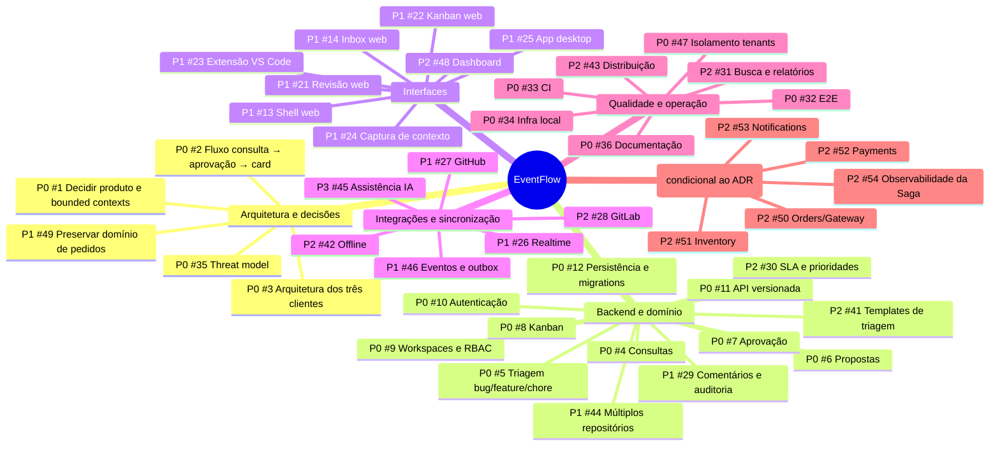
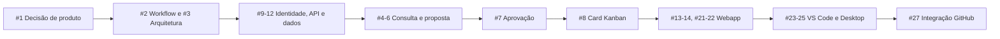

# EventFlow — Mindmap de tarefas

> Mapa de planejamento; P0 = crítico, P1 = alto, P2 = médio, P3 = futuro. Cada nó aponta para uma issue existente. A expansão para gestão de trabalho depende da decisão arquitetural #1.

## Issues por frente

### Arquitetura e decisões

- **P0** [#1 — Decidir produto e bounded contexts](https://github.com/jacksonsr451/EventFlow/issues/1)
- **P0** [#2 — Fluxo consulta → aprovação → card](https://github.com/jacksonsr451/EventFlow/issues/2)
- **P0** [#3 — Arquitetura dos três clientes](https://github.com/jacksonsr451/EventFlow/issues/3)
- **P0** [#35 — Threat model](https://github.com/jacksonsr451/EventFlow/issues/35)
- **P1** [#49 — Preservar domínio de pedidos](https://github.com/jacksonsr451/EventFlow/issues/49)

### Backend e domínio

- **P0** [#9 — Workspaces e RBAC](https://github.com/jacksonsr451/EventFlow/issues/9)
- **P0** [#10 — Autenticação](https://github.com/jacksonsr451/EventFlow/issues/10)
- **P0** [#11 — API versionada](https://github.com/jacksonsr451/EventFlow/issues/11)
- **P0** [#12 — Persistência e migrations](https://github.com/jacksonsr451/EventFlow/issues/12)
- **P0** [#4 — Consultas](https://github.com/jacksonsr451/EventFlow/issues/4)
- **P0** [#5 — Triagem bug/feature/chore](https://github.com/jacksonsr451/EventFlow/issues/5)
- **P0** [#6 — Propostas](https://github.com/jacksonsr451/EventFlow/issues/6)
- **P0** [#7 — Aprovação](https://github.com/jacksonsr451/EventFlow/issues/7)
- **P0** [#8 — Kanban](https://github.com/jacksonsr451/EventFlow/issues/8)
- **P1** [#29 — Comentários e auditoria](https://github.com/jacksonsr451/EventFlow/issues/29)
- **P1** [#44 — Múltiplos repositórios](https://github.com/jacksonsr451/EventFlow/issues/44)
- **P2** [#30 — SLA e prioridades](https://github.com/jacksonsr451/EventFlow/issues/30)
- **P2** [#41 — Templates de triagem](https://github.com/jacksonsr451/EventFlow/issues/41)

### Interfaces

- **P1** [#13 — Shell web](https://github.com/jacksonsr451/EventFlow/issues/13)
- **P1** [#14 — Inbox web](https://github.com/jacksonsr451/EventFlow/issues/14)
- **P1** [#21 — Revisão web](https://github.com/jacksonsr451/EventFlow/issues/21)
- **P1** [#22 — Kanban web](https://github.com/jacksonsr451/EventFlow/issues/22)
- **P2** [#48 — Dashboard](https://github.com/jacksonsr451/EventFlow/issues/48)
- **P1** [#23 — Extensão VS Code](https://github.com/jacksonsr451/EventFlow/issues/23)
- **P1** [#24 — Captura de contexto](https://github.com/jacksonsr451/EventFlow/issues/24)
- **P1** [#25 — App desktop](https://github.com/jacksonsr451/EventFlow/issues/25)

### Integrações e sincronização

- **P1** [#27 — GitHub](https://github.com/jacksonsr451/EventFlow/issues/27)
- **P2** [#28 — GitLab](https://github.com/jacksonsr451/EventFlow/issues/28)
- **P1** [#26 — Realtime](https://github.com/jacksonsr451/EventFlow/issues/26)
- **P2** [#42 — Offline](https://github.com/jacksonsr451/EventFlow/issues/42)
- **P1** [#46 — Eventos e outbox](https://github.com/jacksonsr451/EventFlow/issues/46)
- **P3** [#45 — Assistência IA](https://github.com/jacksonsr451/EventFlow/issues/45)

### Qualidade e operação

- **P0** [#32 — E2E](https://github.com/jacksonsr451/EventFlow/issues/32)
- **P0** [#33 — CI](https://github.com/jacksonsr451/EventFlow/issues/33)
- **P0** [#34 — Infra local](https://github.com/jacksonsr451/EventFlow/issues/34)
- **P0** [#36 — Documentação](https://github.com/jacksonsr451/EventFlow/issues/36)
- **P0** [#47 — Isolamento tenants](https://github.com/jacksonsr451/EventFlow/issues/47)
- **P2** [#31 — Busca e relatórios](https://github.com/jacksonsr451/EventFlow/issues/31)
- **P2** [#43 — Distribuição](https://github.com/jacksonsr451/EventFlow/issues/43)

### Domínio legado de pedidos (condicional ao ADR)

- **P2** [#50 — Orders/Gateway](https://github.com/jacksonsr451/EventFlow/issues/50)
- **P2** [#51 — Inventory](https://github.com/jacksonsr451/EventFlow/issues/51)
- **P2** [#52 — Payments](https://github.com/jacksonsr451/EventFlow/issues/52)
- **P2** [#53 — Notifications](https://github.com/jacksonsr451/EventFlow/issues/53)
- **P2** [#54 — Observabilidade da Saga](https://github.com/jacksonsr451/EventFlow/issues/54)

## Caminho crítico

**Regra de negócio:** uma consulta não é uma tarefa aprovada; propostas só geram cards após aprovação autorizada e idempotente. Bugs, features e chores possuem critérios de triagem distintos. Issues #50–54 permanecem condicionadas à decisão de separação dos domínios.
